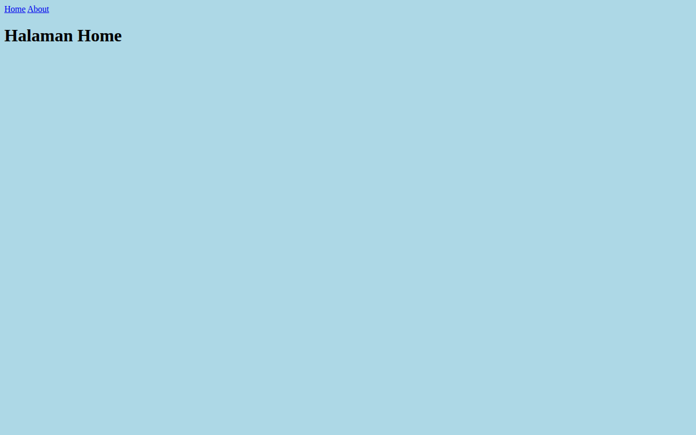

# Web Artikel Laravel

Website sederhana berbasis Laravel 12 yang berisi dua halaman statis, yaitu halaman Home dan halaman About. Proyek ini dibuat sebagai latihan dasar penggunaan route dan view pada Laravel.

## Fitur

- Halaman Home pada route `/`
- Halaman About pada route `/about` yang menampilkan nama pemilik
- Navigasi tautan antara halaman Home dan About
- Tampilan memakai Blade dengan file CSS dan JavaScript terpisah di folder `public`

## Teknologi

- PHP 8.2 atau lebih baru
- Laravel 12
- Blade
- Vite dan Tailwind CSS 4 untuk aset frontend
- SQLite sebagai database bawaan

## Cara Instalasi

Prasyarat:

- PHP 8.2 atau lebih baru
- Composer
- Node.js dan npm

Langkah instalasi:

```bash
git clone https://github.com/bintangyudhis/web-artikel-laravel.git
cd web-artikel-laravel
composer install
npm install
cp .env.example .env
php artisan key:generate
php artisan migrate
```

## Cara Menjalankan

Jalankan server pengembangan Laravel:

```bash
php artisan serve
```

Buka `http://localhost:8000` di browser. Halaman About dapat diakses di `http://localhost:8000/about`.

Untuk menjalankan Laravel bersama Vite dan layanan pendukung lain dalam satu perintah:

```bash
composer run dev
```

## Tangkapan Layar



## Lisensi

Proyek ini memakai lisensi MIT. Lihat berkas [LICENSE](LICENSE) untuk teks lengkapnya.
